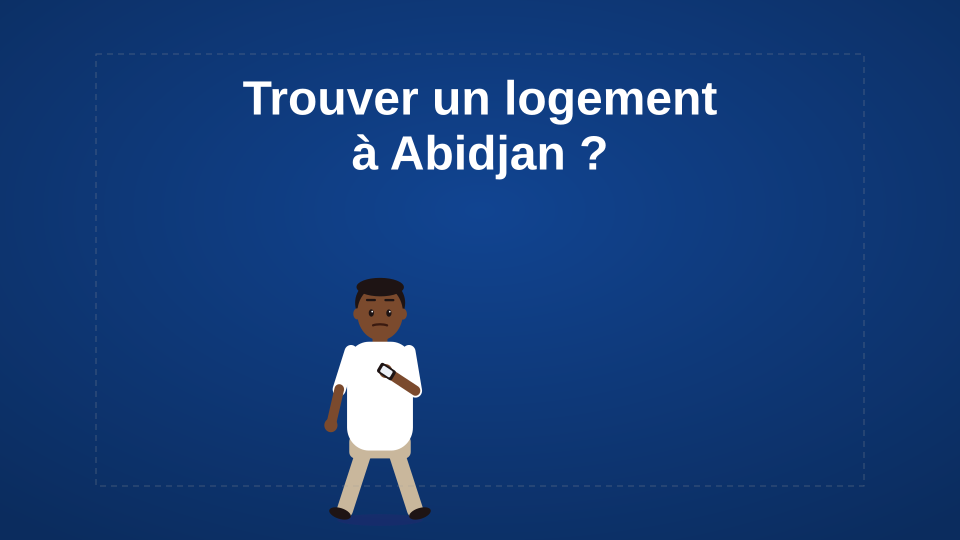
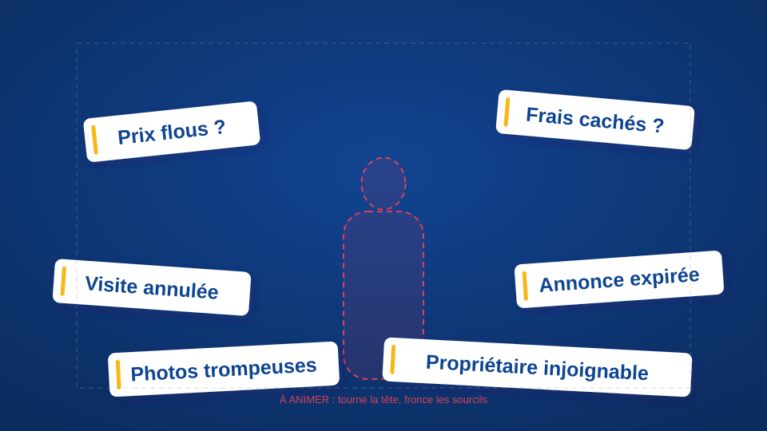
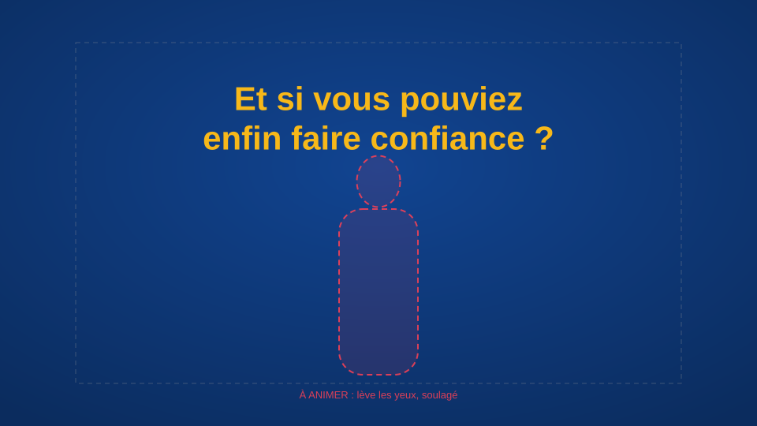
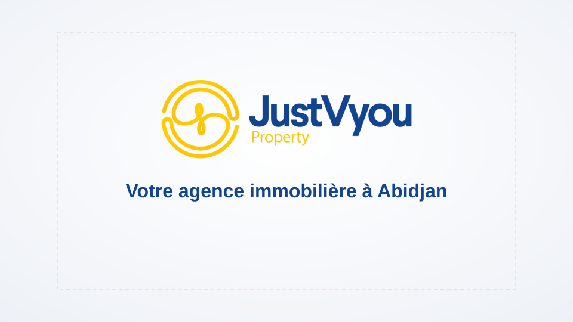
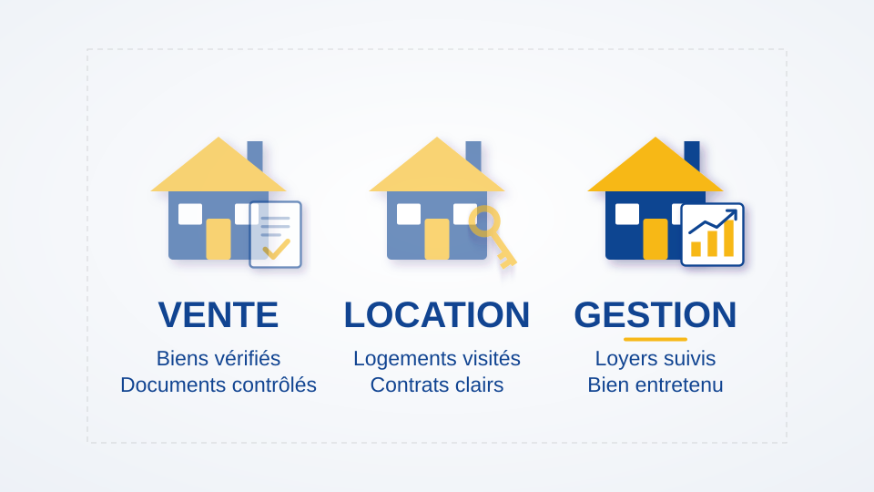
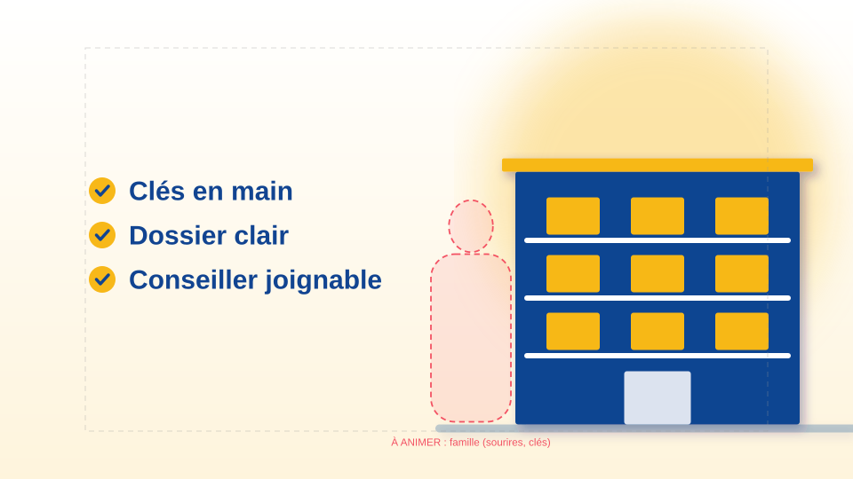
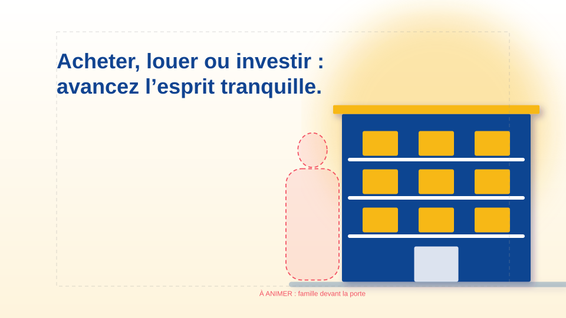
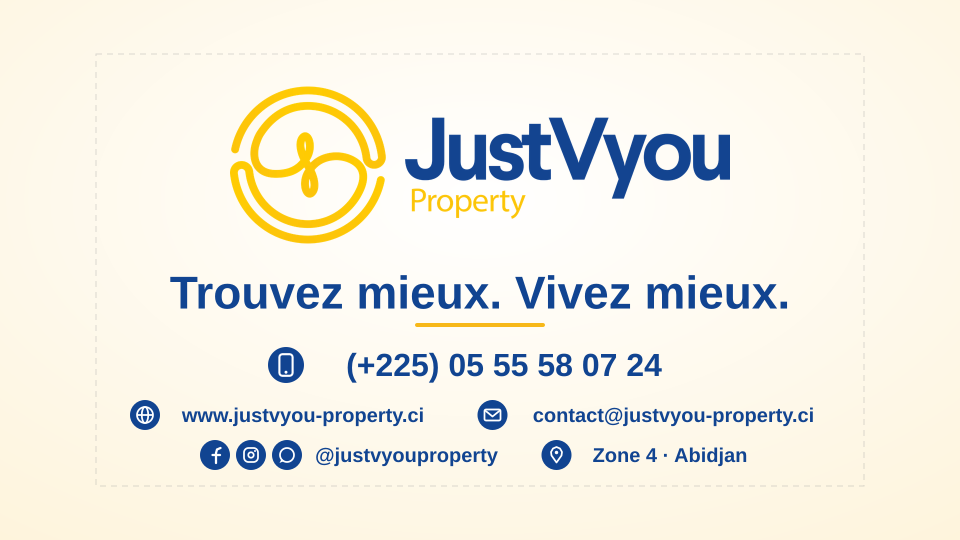

# 2. Storyboard séquence par séquence — Spot « Justvyou Property » (60 s)

**Composition :** `SPOT_JUSTVYOU_60S`, 1920×1080, 30 i/s, 00:00 → 01:00
**Charte :** bleu `#114491` (confiance), or `#F7B819` (prestige), blanc (respiration). Les dégradés n'utilisent que des nuances de ces trois couleurs : bleu assombri `#0B2C5E`, or éclairci `#FEF4DC`, bleu éclairci `#ECF0F6`.
**Style :** flat design 2D épuré, formes arrondies, ombres portées teintées violet/bleu `#2F2370` à 35 %, grain léger, lueur douce.
**Typographie :** Larsseit ExtraBold/Bold pour les titres, Regular pour les détails (Montserrat en repli).

| Scène | Pré-composition | Début | Fin | Durée | Images |
|---|---|---|---|---|---|
| 1 | `SC01_CLIENT_PERDU` | 00:00 | 00:15 | 15 s | 0 → 449 |
| 2 | `SC02_DECOUVERTE_SERVICES` | 00:15 | 00:35 | 20 s | 450 → 1 049 |
| 3 | `SC03_FAMILLE_SATISFAITE` | 00:35 | 00:50 | 15 s | 1 050 → 1 499 |
| 4 | `SC04_LOGO_CONTACTS` | 00:50 | 01:00 | 10 s | 1 500 → 1 799 |
| **Total** | | | | **60 s** | **1 800 images** |

Les timecodes sont continus : chaque scène commence exactement à l'image où la précédente s'arrête. Les transitions sont des calques posés **au-dessus** des scènes, dans la composition principale. Ils couvrent l'écran pendant la coupe franche, sans chevauchement de scènes.

Les vignettes ci-dessous reprennent les positions exactes du script JSX. Le cadre pointillé gris figure la zone titre (10 %). Les silhouettes rouges en pointillés sont les repères des personnages à animer à la main ; ce sont des calques guides, non rendus.

---

## Scène 1 — Le client perdu face à des offres immobilières confuses (00:00 → 00:15)

**Intention :** faire ressentir la saturation et la méfiance du marché, puis ouvrir une porte : « et si vous pouviez faire confiance ? »

| Plan | Timecode | Vignette |
|---|---|---|
| 1A | 00:00 → 00:04 |  |
| 1B | 00:04 → 00:09,2 |  |
| 1C | 00:09,2 → 00:15 |  |

**Description visuelle**
- **1A (00:00 → 00:04).** Fond en dégradé radial bleu `#114491` → bleu nuit, dont le centre lumineux dérive lentement. Le client, un homme ou une femme de 30 à 40 ans en tenue de ville, entre en marchant, les yeux sur son téléphone. Le titre **« Trouver un logement à Abidjan ? »** monte depuis le bas en fondu.
- **1B (00:04 → 00:09,2).** Six cartes d'annonce blanches, chacune avec un liseré or, surgissent en pop-up avec stretch & squash, une toutes les 0,55 s : *Prix flous ?*, *Frais cachés ?*, *Visite annulée*, *Annonce expirée*, *Photos trompeuses*, *Propriétaire injoignable*. Elles flottent et oscillent de façon désordonnée autour du client, qui tourne la tête de l'une à l'autre, cligne des yeux et fronce les sourcils.
- **1C (00:09,2 → 00:15).** Les cartes se rétractent. **« Trop d'offres. Trop de doutes. »** apparaît en blanc, en grand (pop-up). Le client se gratte la tête, les épaules s'affaissent (squash). À 12,3 s, il lève les yeux et la question **« Et si vous pouviez enfin faire confiance ? »** glisse en or.

**Caméra et calques**
- Null `CAM_SC01` : push-in continu de 100 à 108 % et roulis inquiet (`wiggle(0.5, 1.2)` sur la rotation), qui traduit la confusion.
- Cartes : `wiggle(0.8, 18)` sur la position, `wiggle(0.6, 3)` sur la rotation.

**Couleurs :** fond bleu → bleu nuit ; textes blancs ; promesse en or (première apparition de l'or, qui annonce la marque).

**Transition vers la scène 2 :** volet **or puis bleu** de gauche à droite (`TR_01`, de 14,55 à 15,45 s). Il couvre tout l'écran à 15,0 s pile, avec un flou de mouvement.

---

## Scène 2 — Découverte de Justvyou Property et de ses trois services (00:15 → 00:35)

**Intention :** passer de l'ombre à la lumière. La marque apparaît, puis trois services clairs : vente, location, gestion.

| Plan | Timecode | Vignette |
|---|---|---|
| 2A | 00:15 → 00:19 |  |
| 2B | 00:19 → 00:35 |  |

**Description visuelle**
- **2A (00:15 → 00:19).** Fond blanc avec dégradé radial vers un bleu très pâle. Le **logo complet** fait un pop-up au centre (y = 400), suivi de **« Votre agence immobilière à Abidjan »** qui glisse en dessous.
- **2B (00:19 → 00:35).** Le logo se rétracte et trois colonnes se construisent tour à tour, chacune au moment où la voix off nomme le service :
  - **VENTE (19 s, x = 480).** Une maison 2D (murs bleus, toit et porte or, fenêtres blanches) tombe et rebondit (stretch & squash), puis un **contrat** avec une coche dorée apparaît à côté. Le titre **VENTE** est suivi d'un soulignement or qui se déploie, puis du texte *Biens vérifiés / Documents contrôlés*.
  - **LOCATION (24 s, x = 960).** Maison 2, puis une **clé** or qui tourne d'un quart de tour (90°). Texte *Logements visités / Contrats clairs*.
  - **GESTION (29 s, x = 1440).** Maison 3, puis une carte avec un **graphique** à barres or et une flèche montante. Texte *Loyers suivis / Bien entretenu*.
  - Quand une colonne arrive, les maisons précédentes s'estompent à 60 % et leur soulignement or disparaît : le soulignement indique toujours le service dont parle la voix off. Les textes restent à 100 % pour rester lisibles.

**Caméra et calques**
- `CAM_SC02` : push-in de 100 à 104 % et travelling latéral lent (+15 px → −15 px).
- Maisons et accessoires : pop-up avec squash ancré au sol. L'accessoire est parenté à sa maison.
- Ombres portées teintées, Incrustation en dégradé « Réfléchi » à 15 % et Lueur interne blanche sur les maisons et les accessoires (rim light).

**Couleurs :** blanc dominant, bleu pour les structures et les titres, or pour les toits, les portes, la clé, les barres et les soulignements.

**Transition vers la scène 3 :** volet **bleu puis or** de droite à gauche (`TR_02`, de 34,55 à 35,45 s). Il couvre l'écran à 35,0 s.

---

## Scène 3 — Famille satisfaite dans un logement moderne à Abidjan (00:35 → 00:50)

**Intention :** montrer le résultat. La sérénité, la sécurité et un bien moderne.

| Plan | Timecode | Vignette |
|---|---|---|
| 3A | 00:35 → 00:45 |  |
| 3B | 00:45 → 00:50 |  |

**Description visuelle**
- **Décor.** Dégradé vertical blanc → or pâle, halo de soleil or flouté derrière un **immeuble moderne** : façade bleue, toiture or, 9 fenêtres éclairées en or, balcons blancs, entrée vitrée. L'immeuble monte depuis le bas en décélérant.
- **35 → 40 s.** **« Chez vous, enfin. »** glisse à gauche. La famille (deux parents et un enfant) sourit et cligne des yeux devant l'entrée ; l'enfant court vers la porte.
- **40 → 45 s.** Trois pastilles or avec coche bleue font un pop-up l'une après l'autre (0,5 s d'écart), suivies de **Clés en main**, **Dossier clair** et **Conseiller joignable** (slide depuis la gauche). Un parent reçoit les clés et serre la main du conseiller.
- **45 → 50 s.** **« Acheter, louer ou investir : avancez l'esprit tranquille. »** La famille entre et la porte se referme doucement.

**Caméra et calques**
- `CAM_SC03` : push-in de 100 à 105 % et travelling de −20 px à +20 px.
- Ombre portée teintée et styles de calque sur l'immeuble. Rim lights blanches discrètes sur la peau des personnages, à faire à la main.

**Couleurs :** lumière chaude (blanc et or pâle), architecture bleue, accents or. Ambiance de fin d'après-midi à Abidjan.

**Transition vers la scène 4 :** **iris or** (`TR_03`). Un disque or grandit depuis le centre de 49,55 à 50,0 s, couvre l'écran à la coupe, puis se dissout jusqu'à 50,4 s. Il fait écho au symbole circulaire du logo.

---

## Scène 4 — Logo animé, slogan, contacts, site web et réseaux sociaux (00:50 → 01:00)

**Intention :** signer, faire mémoriser et donner les moyens d'agir.

| Plan | Timecode | Vignette |
|---|---|---|
| 4A | 00:50 → 01:00 |  |

**Description visuelle**
- **50,4 s.** Le **symbole** or fait un pop-up en tournant de −120° à 0°.
- **50,9 s.** Le **logotype** « JustVyou Property » glisse depuis le symbole. Un **reflet lumineux** (CC Light Sweep) le balaie de gauche à droite vers 52,2 s.
- **53,3 s.** **« Trouvez mieux. Vivez mieux. »** apparaît en cascade, lettre à lettre. Le soulignement or se déploie à 53,9 s.
- **55,5 → 56,5 s.** Les coordonnées montent rangée par rangée (0,5 s d'écart) :
  1. pastille téléphone + **(+225) 05 55 58 07 24** (le plus grand, 64 px) ;
  2. globe + **www.justvyou-property.ci**, enveloppe + **contact@justvyou-property.ci** ;
  3. Facebook, Instagram et WhatsApp + **@justvyouproperty**, épingle + **Zone 4 · Abidjan**.
- **56,5 → 60 s.** Plan fixe, tout reste lisible au moins 3,5 s. Pas de fondu au noir : le spot finit sur la carte de visite.

**Caméra et calques**
- `CAM_SC04` : push-in très léger (100 → 102 %), presque un plan fixe pour la lisibilité.
- Aucune animation de sortie dans cette scène : tout reste affiché jusqu'à 01:00.

**Couleurs :** fond blanc avec dégradé radial vers l'or pâle, logo dans ses couleurs d'origine, textes bleus, pastilles bleues à pictogramme blanc.

---

## Finitions communes (calque `ADJ_FINAL`, en haut de la pile)

1. **Lueur** : seuil 85 %, rayon 22, intensité 0,3.
2. **Grain** : Bruit à 6,5 % (plage 5 à 8 %), monochrome, avec l'expression `posterizeTime(12); linear(wiggle(10, 10), value - 10, value + 10, 5, 8);`.
3. **Aberration chromatique** : Quick Chromatic Aberration, si le plug-in est installé, à 1 à 3 px.
4. **Étalonnage léger** : Teinte à 8 % (noirs vers bleu nuit, blancs à peine chauds).

Les solides de fond portent aussi un grain léger (2 à 4 %) animé par la même expression.

---

## Ce qui est automatisé et ce qui reste à animer

| Élément | Automatisé par le JSX | À faire à la main |
|---|---|---|
| Compositions, dossiers, durées, marqueurs, guides | ✅ | — |
| Fonds dégradés et grain | ✅ | — |
| Textes, animations d'entrée et de sortie (pop-up, slide, fondu, cascade) | ✅ | Ajustements de goût sur les courbes |
| Maisons, clé, contrat, graphique, immeuble, pictogrammes | ✅ (formes vectorielles) | Détails illustratifs (végétation, textures) |
| Ombres portées teintées | ✅ | — |
| Incrustation en dégradé « Réfléchi » et Lueur interne | ⚠️ Au mieux, via les menus | Couleurs du dégradé (non scriptables) |
| Logo animé et reflet | ✅ | — |
| Transitions (volets, iris) | ✅ | Sound design des swooshes |
| Lueur, grain, aberration chromatique, étalonnage | ✅ (aberration seulement si le plug-in est présent) | Dosage final |
| **Personnages** (client, famille, conseiller) | ❌ Repères guides seulement | Dessin, stretch & squash, clignements, paupières, sourires, mains, marche, tête |
| Masques adoucis, rim lights sur la peau | ❌ | ✅ |
| Voix off, musique, mixage | ⚠️ Import automatique si les fichiers sont dans `assets/audio/` | Enregistrement, mixage |
| Rendu final | ❌ | ✅ (H.264, 1080p, 30 i/s) |
